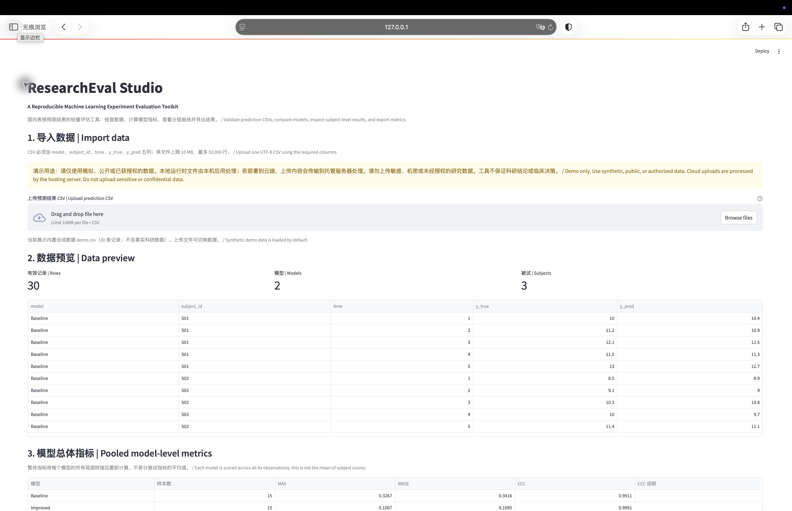
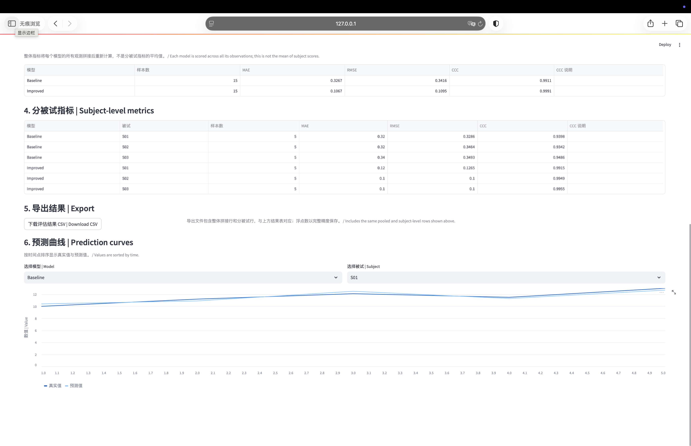

# ResearchEval Studio v0.1

[中文说明](#中文说明) · [English](#english)

**A Reproducible Machine Learning Experiment Evaluation Toolkit**

> The screenshots use synthetic demo data only. This is a technical demonstration, not a validated clinical or research decision system.

Repository: https://github.com/Ruihanchen-max/research-eval-studio

## 中文说明

ResearchEval Studio 将预测结果 CSV 转换为经过数据检查、口径明确且可下载的回归评估结果。项目内的 demo.csv 是人工构造的合成示例，不含真实科研数据。

### 功能

- 校验必需字段、数值、缺失/无限值和重复记录，并保留 001 等字符串编号的前导零。
- 计算每个模型的整体拼接指标，以及每个模型、每个被试的独立指标。
- 展示数据摘要、结果表和真实值/预测值曲线，并导出完整精度 CSV。
- 使用 pytest 和 Streamlit AppTest 验证指标、边界和界面行为。

整体指标是同一模型全部观测拼接后重新计算的结果，不是分被试指标的平均值。

### 输入与输出

CSV 必须包含 model、subject_id、time、y_true、y_pred 五列。model 和 subject_id 是非空文本；其余字段必须是有限数值；model + subject_id + time 必须唯一。输出包含 overall_pooled 和 subject 两种 scope，以及样本数、MAE、RMSE、CCC 和 CCC 未定义说明。

### 指标

MAE = (1/n) Σ |y - p|；RMSE = sqrt((1/n) Σ (y - p)^2)；Lin's CCC = 2 cov(y,p) / [var(y) + var(p) + (mean(y)-mean(p))^2]。方差和协方差采用总体矩（ddof=0）；CCC 至少需要两个观测，相同常数序列的 CCC 未定义。

### 本地运行

需要 Python 3.12：python3.12 -m venv .venv-py312；source .venv-py312/bin/activate；python -m pip install -r requirements.txt；streamlit run app.py。应用默认加载 demo.csv。测试命令：python -m pytest -q。

requirements.txt 通过 -r requirements-py312.lock 引用固定依赖。GitHub Actions 已在 Ubuntu / Python 3.12 上通过两个依赖入口运行测试，最新结果见 https://github.com/Ruihanchen-max/research-eval-studio/actions/runs/40199675356。部署入口为 app.py、Python 3.12；上传限制见 .streamlit/config.toml。在线演示链接将在部署完成并实际验证后补充。

### CSV 导出安全

导出副本会对可能被电子表格解释为公式的文本，包括 =、+、-、@、全角形式及前导 Unicode 空白/控制字符，添加前导单引号；原始数据、分组和数值指标不变。普通编号 001、Model-1 不变，文本 -1 会被保护，真正的负数指标仍是数值。CSV 不携带列类型，导出安全不是通用的电子表格安全保证。参见 OWASP CSV Injection。

### 演示范围与数据提示

请使用模拟、公开或获得授权的数据。当前上限为单文件 10 MB、50,000 行和 2,000 个模型-被试组合。部署到 Streamlit Community Cloud 时，上传数据会传输到托管服务器；项目不保证敏感数据隔离、安全删除或隐私保护，也不保证临床决策或科研结论。当前仅支持数值型回归预测。

### 许可证

本项目采用 MIT License，软件按现状提供。

## English

ResearchEval Studio turns a prediction-result CSV into validated, clearly scoped regression metrics and a downloadable result table. The bundled demo.csv contains synthetic examples only.

### Features

- Validates required columns, numeric values, missing or non-finite values, and duplicates while preserving identifiers such as 001.
- Calculates pooled model metrics and separate model-subject metrics.
- Shows summaries, result tables, true-versus-predicted curves, and full-precision CSV export.
- Uses pytest and Streamlit AppTest for metrics, boundaries, and interface behavior.

The pooled score is recalculated from all observations for a model; it is not the average of subject scores. CSV fields are model, subject_id, time, y_true, and y_pred. Numeric fields must be finite and model + subject_id + time must be unique.

Use Python 3.12. Install with requirements.txt and run streamlit run app.py. GitHub Actions has passed both pinned dependency-entry jobs on Ubuntu / Python 3.12 in the linked Run #6. Select app.py and Python 3.12 for deployment; an online link will be added only after real deployment verification.

Export copies prefix formula-like text with an apostrophe. Internal grouping and numeric metrics remain unchanged. Spreadsheet behavior varies, so this is not a universal security guarantee. Use synthetic, public, or authorized data only; cloud uploads are transmitted to the hosting server. The tool supports numeric regression only and has no database, accounts, SLA, or clinical guarantee.

This project is released under the MIT License and provided as is.
